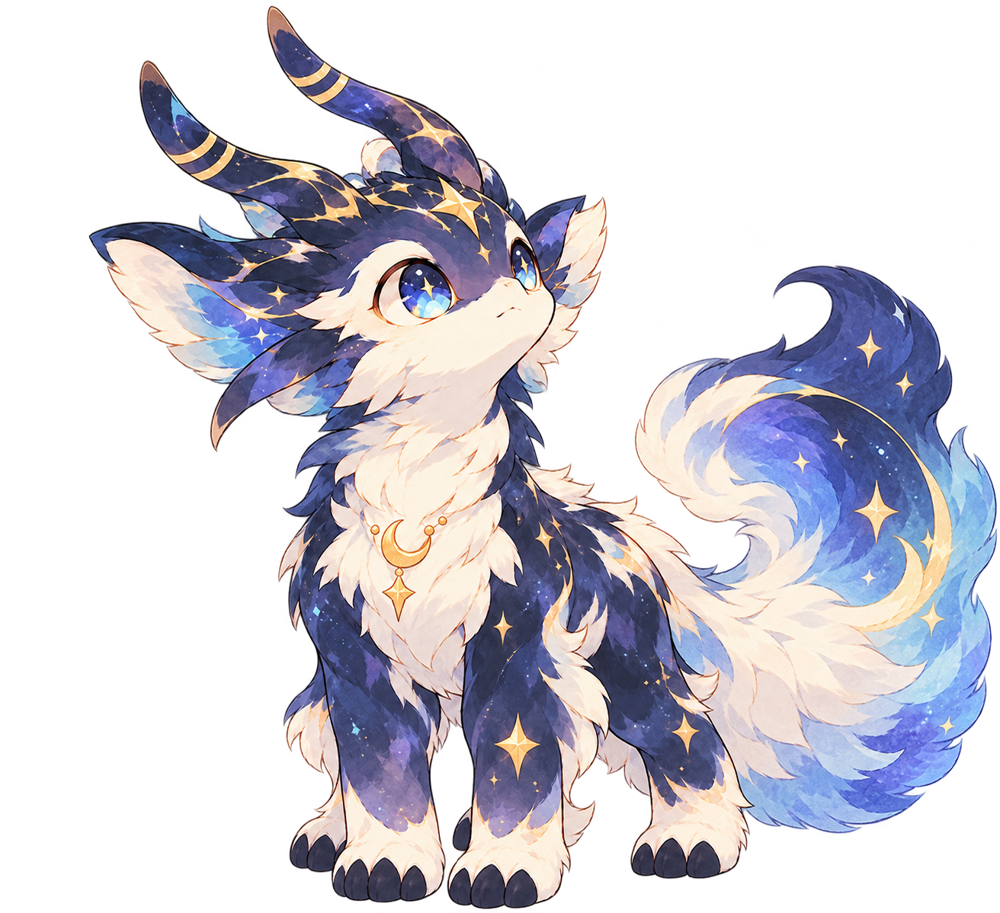
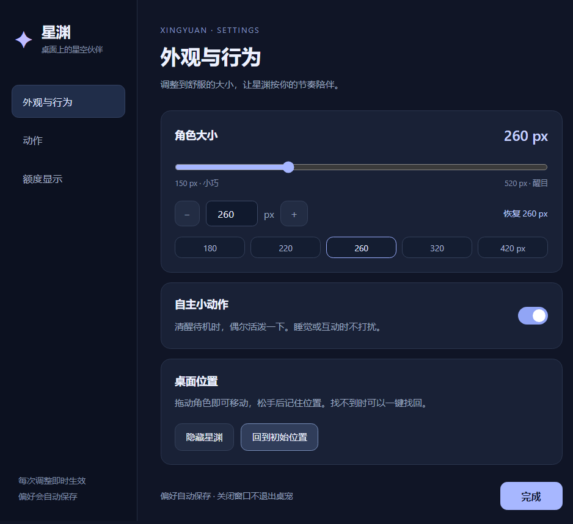

# 星渊桌宠 · Xingyuan Desktop Pet

一只在桌面陪伴的星空伙伴。用预渲染的透明视频表现角色，以 Electron 提供桌面互动；不是运行时 3D 模型。



当前存档：**v0.5.0 · 统一设置版**。本仓库只保存当前视频版源码和必要素材，不混入旧 3D 工程或开发者的个人数据。

## 直接使用

前往 [Releases](https://github.com/Xingchen-stars/xingyuan-desktop-pet/releases) 下载 `xingyuan-desktop-pet-v0.5.0-win-x64.zip`，完整解压，再打开其中的 **星渊桌宠.exe**。请保留整个文件夹，不能只拿走 EXE。此版本为 Windows x64 便携应用，不是安装程序。

发布文件未做代码签名。可用发布附件中的 SHA-256 检查文件完整性，再自行决定是否运行；不建议关闭系统安全保护。

## 已有功能

- 安静待机、活泼一下、进入睡眠、熟睡循环，双视频层平滑切换。
- 无标题透明角色窗口；鼠标移到角色时才显示 `⋮ / — / ×`。
- 透明空白点击穿透；角色本体可轻点回弹、拖动，保留位置记忆与一键找回。
- 统一设置页：角色大小、自主小动作、显示/隐藏、动作和额度卡片选项。
- 自定义大小 150–520 px，默认 260 px；自主动作可关闭。
- 系统托盘、单实例唤回、隐藏到后台。`—` 隐藏，`×` 退出应用。
- Codex 额度只读显示；WorkBuddy 仅保留选择入口，积分读取**尚未接通**，不显示虚构余额。

在角色菜单或托盘菜单中打开 **设置…**。大小和开关即时生效并保存，关闭设置窗口不会退出桌宠。原有菜单快捷项仍保留。



## 从源码运行

需要 Windows、Node.js/npm。建议使用受支持的 Node.js LTS 版本。

```powershell
npm install
npm test
npm start
```

构建便携应用：

```powershell
npm run build:portable
```

构建前先退出正在运行的同目录便携应用。输出在 `versions/xingyuan-video-v1/dist/星渊桌宠-portable/`；旧构建会保留为 `星渊桌宠-previous-*`，不会先删旧包。

## 结构与素材

```text
versions/xingyuan-video-v1/
  preview/           Electron 主进程、界面、命中检测和额度适配
  reference/         角色参考图
  edit/animations/   四段运行所需的 VP9 Alpha WebM
  构建便携应用.ps1
tests/               Alpha 命中与窗口几何测试
```

运行时使用当前视频帧的 Alpha 判断角色命中，而不是整块矩形。Windows 关闭硬件加速以规避透明视频隐藏 RGB 显示成横条的问题。四种动作来自用户提供的角色视频，经本地透明化处理；本仓库不包含原视频、处理缓存和旧 3D。

## 额度与隐私

Codex 功能需要本机已经安装并登录对应客户端，由其本地 app-server 完成认证和额度查询。星渊不读取或复制认证文件，不要求手填 Token，不发起模型对话。安装位置或客户端协议变化可能使该功能暂不可用。

WorkBuddy 目前没有本项目已验证的安全积分读取桥，显示未接通。没有自动购买、开机自启或账户修改。

用户偏好仅保存在 Electron 的本地用户数据目录，不在本仓库中。公开存档不包含个人配置、凭据、聊天、内部接力记录、日志或测试缓存。

## 验证与当前限制

本机 Windows 对源码和便携 EXE 分别验证统一设置、原有动作/位置/大小和透明命中流程。`npm test` 包含 18 项纯逻辑检查，不等同于完整桌面鼠标测试。

仍需长期反馈：不同 Windows 环境、混合 DPI 多屏热插拔、透明细毛边缘容差。尚无观察、走路、专门点击回应或起身视频；当前回弹只是轻微交互反馈。此项目不是 Codex / WorkBuddy 官方产品。

## 致谢与许可说明

透明视频播放和部分交互思路参考 [PC2005-cloud/dsh-pet](https://github.com/PC2005-cloud/dsh-pet)，详见 [NOTICE](NOTICE.md)。没有使用其大肥鱼动画素材。

本仓库尚未另行指定项目代码与星渊素材的开放许可证；需要使用时请先联系仓库所有者，并遵守第三方许可说明。公开存档不表示对第三方素材权利作出额外保证。
